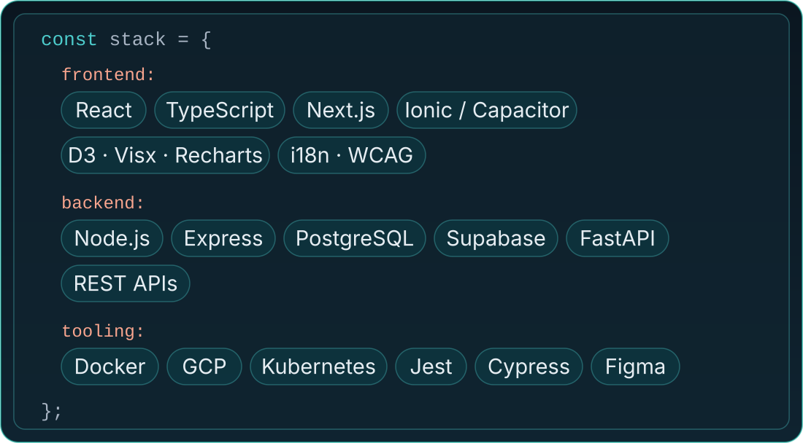

  

<h3 align="center">Full-Stack &amp; Frontend Engineer · Implementation &amp; Solutions</h3>

I turn client needs into production software with React, Next.js, TypeScript and Node.js. 
Switzerland · Remote · Open to frontend, full-stack, implementation, solutions and forward deployed engineer roles

  

- **Hivepower, Frontend Lead (2023–2025):** built the whitelabel React platform that took the company from 1 to 5+ enterprise clients and made onboarding ~5× faster.
- **ClearMix, Frontend Engineer (2021–2022):** led a real-time logistics app and helped cut failed studio recordings by ~65%.
- **Now:** delivering client projects end to end and training in forward deployed engineering and AI.

I work directly with clients, turn fuzzy requirements into clear specs, and ship them to production.

  

  
  
  
  

  <a href="https://melina-zellweger.vercel.app">melina-zellweger.vercel.app</a> ·
  <a href="https://www.linkedin.com/in/melina-zellweger-">LinkedIn</a> ·
  <a href="mailto:zmelina99@gmail.com">zmelina99@gmail.com</a> ·
  <a href="https://wa.link/59l0oa">WhatsApp</a>

