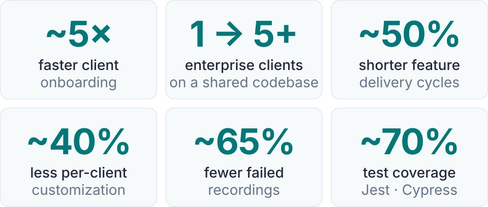

<picture>
  <source media="(max-width: 600px)" srcset="./assets/banner-mobile.svg" />
  
</picture>

### Software Engineer | Frontend, Product & Solutions Engineering

**I turn complex business requirements into scalable, production-ready software.**

4+ years of experience building enterprise applications, leading frontend architecture and owning technical delivery from discovery to production. I combine hands-on engineering, product thinking and client collaboration, with a growing focus on Forward Deployed Engineering, Implementation Engineering and customer-facing technical solutions.

Swiss-Argentinian · Based in Switzerland · Open to remote

## Impact in numbers

<picture>
  <source media="(max-width: 600px) and (prefers-color-scheme: dark)" srcset="./assets/impact-mobile-dark.svg" />
  <source media="(max-width: 600px)" srcset="./assets/impact-mobile-light.svg" />
  <source media="(prefers-color-scheme: dark)" srcset="./assets/impact-desktop-dark.svg" />
  
</picture>

Impact metrics as text

- **Hivepower:** ~5× faster client onboarding · 1 → 5+ enterprise clients on a shared codebase · ~50% shorter feature delivery cycles · ~40% less per-client customization
- **ClearMix:** ~65% fewer failed recordings · ~70% test coverage with Jest and Cypress

## Selected work

### [Hivepower · Enterprise Energy Platform ↗](https://melina-zellweger.vercel.app/#case-studies)

`Private enterprise codebase` · Full-Stack Engineer (Frontend Lead) · 2023 – 2025

Owned the frontend architecture of a multi-tenant whitelabel platform for web, iOS and Android. Brand themes, feature flags and i18n turned each new enterprise client into configuration instead of a rebuild. Built the real-time energy data visualization system, led performance work and owned production releases.\
React · TypeScript · Nx · Ionic · Capacitor · D3 · Recharts · Visx

### ClearMix · Media & Logistics Platform

`Private enterprise codebase` · Frontend Engineer · 2021 – 2022

Led development of the real-time scheduling and logistics app, helped architect a cloud-synced virtual recording studio and strengthened automated testing across the frontend.\
React · Next.js · Google Maps · Jest · Cypress · [Experience on my portfolio ↗](https://melina-zellweger.vercel.app/#experience)

### [Bilingue.ch · Client Project ↗](https://bilingue-eta.vercel.app/)

`Preview deployment` `Public repository` · Software Engineer & Technical Consultant · 2026 – present

Owned delivery end to end for a language-coaching business: client discovery and requirements, UX/UI design, then a reusable Next.js architecture with German, French and English content, multilingual metadata, sitemaps and technical SEO.\
Next.js · TypeScript · Tailwind CSS · [Code ↗](https://github.com/zmelina99/bilingue)

### [Personal Portfolio ↗](https://melina-zellweger.vercel.app/)

`Production` `Public repository` · Design and development

Designed and built my personal site: an underwater visual identity, interactive depth navigation, case studies and three languages.\
Next.js · TypeScript · Tailwind CSS · shadcn/ui · [Code ↗](https://github.com/zmelina99/portfolio)

## Technical expertise

<picture>
  <source media="(max-width: 600px) and (prefers-color-scheme: dark)" srcset="./assets/stack-mobile-dark.svg" />
  <source media="(max-width: 600px)" srcset="./assets/stack-mobile-light.svg" />
  <source media="(prefers-color-scheme: dark)" srcset="./assets/stack-desktop-dark.svg" />
  
</picture>

Technical expertise as text (core skills in bold)

- **Frontend & Architecture:** **React**, **TypeScript**, **Next.js**, **Nx**, **Ionic**, **Capacitor**, **D3**, JavaScript, Tailwind CSS, Material UI, Storybook, Recharts, Visx, i18n, WCAG
- **Backend & Integrations:** **Node.js**, **REST APIs**, Express, FastAPI, PostgreSQL, Firebase, Supabase
- **Cloud & Infrastructure:** Docker, Kubernetes, Google Cloud Platform, Vercel, CI/CD
- **Testing & Performance:** **Jest**, **Cypress**, **React rendering optimization**, Chrome DevTools, browser profiling, lazy loading, bundle size optimization, API caching
- **AI-assisted Development:** Claude Code, GitHub Copilot, AI coding agents

## Beyond the code

PADI scuba diving instructor (hence the whale shark), certified ski instructor, and qualified for the 2026 Swiss National Weightlifting Championship. Teaching divers in three languages, and skiers of every age and level, is where I learned to explain complex things simply.

## Contact

<a href="https://melina-zellweger.vercel.app/"><picture><source media="(prefers-color-scheme: dark)" srcset="./assets/contact-portfolio-dark.svg" /></picture></a>
<a href="https://www.linkedin.com/in/melina-zellweger-"><picture><source media="(prefers-color-scheme: dark)" srcset="./assets/contact-linkedin-dark.svg" /></picture></a>
<a href="mailto:zmelina99@gmail.com"><picture><source media="(prefers-color-scheme: dark)" srcset="./assets/contact-email-dark.svg" /></picture></a>
