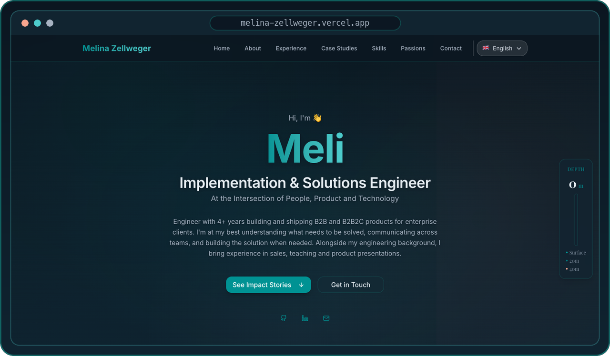

  

<h3 align="center">Implementation &amp; Solutions Engineer · Switzerland</h3>

<em>At the intersection of people, product and technology</em>

## About me

Engineer with 4+ years building and shipping B2B and B2B2C products for enterprise clients. I'm at my best understanding what needs to be solved, communicating across teams, and building the solution when needed. Alongside my engineering background, I bring experience in sales, teaching and product presentations.

- **Hivepower** · Implementation & Solutions Engineer (Frontend Lead) · Feb 2023 – Dec 2025\
  Grew from individual contributor to frontend lead. Built a client's energy-consumption app end to end, and a whitelabel platform (React, Ionic/Capacitor, Nx) that took Hivepower from 1 to 5+ enterprise clients and cut new-client launch time by ~5×.
- **ClearMix** · Frontend Engineer · Jul 2021 – Dec 2022\
  Led frontend development of ClearMix Logistics (Next.js, Google Maps API) and co-built ClearMix Intros, a video-personalization feature for new-customer acquisition.
- **Languages** · Spanish (native) · English (C2) · French (B1)

## Tech stack

  

## Projects

### Portfolio

My personal site, with an underwater theme, case studies and English, Spanish and French versions.\
Next.js · TypeScript · Tailwind CSS · shadcn/ui

[Live site](https://melina-zellweger.vercel.app) · [Code](https://github.com/zmelina99/portfolio)

### ApplyPilot

A personal job-application agent. It discovers roles, filters them against my rules, scores fit against verified experience with Claude, and prepares applications for me to review. It never submits on its own and never invents facts.\
TypeScript · React + Vite · Express · PostgreSQL + Drizzle · Anthropic SDK · Vitest

[Code](https://github.com/zmelina99/ApplyPilot)

### Weightlifting Tracker

A mobile training log for Olympic weightlifting, with training sessions, personal records and progress charts. In progress.\
Ionic React · Capacitor · Visx · Cypress

[Code](https://github.com/zmelina99/weightlifting-tracker)

### Race to Sustainability

A browser racing game: hit renewable energy sources to gain 5 seconds and fossil fuels to lose 10.\
Vanilla JavaScript · HTML · CSS

[Code](https://github.com/zmelina99/race-to-sustainability)

## Get in touch

  
  
  
  

  <a href="https://melina-zellweger.vercel.app">melina-zellweger.vercel.app</a> ·
  <a href="https://www.linkedin.com/in/melina-zellweger-">LinkedIn</a> ·
  <a href="mailto:zmelina99@gmail.com">zmelina99@gmail.com</a> ·
  <a href="https://wa.link/59l0oa">WhatsApp</a>

