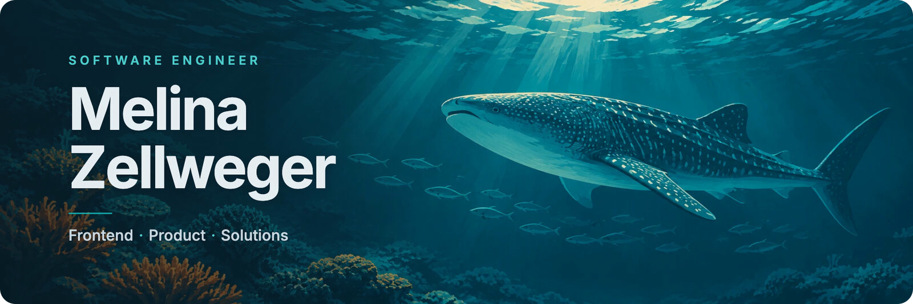

### Software Engineer | Frontend, Product & Solutions Engineering

**I turn complex business requirements into scalable, production-ready software.**

4+ years of experience building enterprise applications, leading frontend architecture and owning technical delivery from discovery to production. Swiss-Argentinian, open to remote roles in frontend, full-stack, product, implementation, solutions and forward-deployed engineering.

## Impact in numbers

<picture>
  <source media="(prefers-color-scheme: dark)" srcset="./assets/impact-dark.svg" />
  
</picture>

## Selected work

**Hivepower · Enterprise Energy Platform**\
Full-Stack Engineer (Frontend Lead) · 2023 – 2025\
Designed and scaled a multi-tenant whitelabel platform for web, iOS and Android, built the real-time data visualization system, optimized frontend performance and owned production delivery.\
React · TypeScript · Nx · Ionic · Capacitor · D3 · Recharts · Visx · Source code is private · [Case studies ↗](https://melina-zellweger.vercel.app/#case-studies)

**ClearMix · Media & Logistics Platform**\
Frontend Engineer · 2021 – 2022\
Developed real-time scheduling and logistics applications, improved cloud synchronization and recording reliability for a virtual recording studio, and contributed to automated testing.\
React · Next.js · Google Maps · Jest · Cypress · Source code is private

**Bilingue.ch · Client Project**\
Software Engineer & Technical Consultant · 2026 – present\
End-to-end delivery of a multilingual website: client discovery, requirements gathering, UX/UI design, reusable frontend architecture, internationalization (German, French, English) and technical SEO.\
Next.js · TypeScript · Tailwind CSS · [Preview deployment ↗](https://bilingue-eta.vercel.app) · [Code ↗](https://github.com/zmelina99/bilingue)

**Personal Portfolio**\
Design and development\
An underwater-themed site in English, Spanish and French, with interactive depth navigation, case studies and a custom visual identity.\
Next.js · TypeScript · Tailwind CSS · shadcn/ui · [Live website ↗](https://melina-zellweger.vercel.app/) · [Code ↗](https://github.com/zmelina99/portfolio)

## Technical expertise

<picture>
  <source media="(prefers-color-scheme: dark)" srcset="./assets/stack-dark.svg" />
  
</picture>

Technical expertise as text (core skills in bold)

- **Frontend & Architecture:** **React**, **TypeScript**, **Next.js**, **Nx**, **Ionic**, **Capacitor**, **D3**, JavaScript, Tailwind CSS, Material UI, Storybook, Recharts, Visx, i18n, WCAG
- **Backend & Integrations:** **Node.js**, **REST APIs**, Express, FastAPI, PostgreSQL, Firebase, Supabase
- **Cloud & Infrastructure:** Docker, Kubernetes, Google Cloud Platform, Vercel, CI/CD
- **Testing & Performance:** **Jest**, **Cypress**, **React rendering optimization**, Chrome DevTools, browser profiling, lazy loading, bundle size optimization, API caching
- **AI-assisted Development:** Claude Code, GitHub Copilot, AI coding agents

## Beyond the code

PADI scuba diving instructor (hence the whale shark), certified ski instructor, and qualified for the 2026 Swiss National Weightlifting Championship. Teaching divers and skiers in three languages is where I learned to explain complex things simply.

## Contact

<a href="https://melina-zellweger.vercel.app/"><picture><source media="(prefers-color-scheme: dark)" srcset="./assets/contact-portfolio-dark.svg" /></picture></a>
<a href="https://www.linkedin.com/in/melina-zellweger-"><picture><source media="(prefers-color-scheme: dark)" srcset="./assets/contact-linkedin-dark.svg" /></picture></a>
<a href="mailto:zmelina99@gmail.com"><picture><source media="(prefers-color-scheme: dark)" srcset="./assets/contact-email-dark.svg" /></picture></a>
