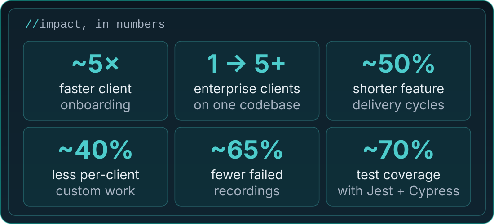
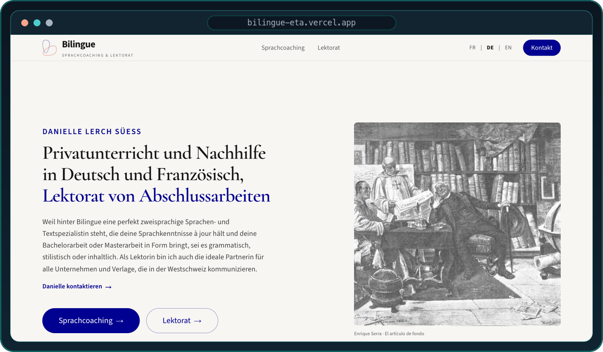

  

<h3 align="center">Full-Stack &amp; Frontend Engineer · Implementation &amp; Solutions</h3>

I turn client needs into production software with React, Next.js, TypeScript and Node.js. 
Switzerland · Remote · Open to frontend, full-stack, implementation, solutions and forward deployed engineer roles

## About me

Software engineer with 4+ years building and shipping enterprise web and mobile apps. At Hivepower I grew from individual contributor to frontend lead, owning the architecture of a whitelabel platform that serves 5+ enterprise clients. I work directly with clients and take products from requirements to production. I'm currently training in forward deployed engineering and AI.

**What I bring**

- **Client-facing delivery:** discovery, requirements and specs with clients, design and backend teams, then shipping and supporting what we agreed.
- **Frontend depth:** architecture, reusable component systems, real-time data visualization, performance profiling, accessibility (WCAG) and i18n.
- **Full-stack and cloud:** Node.js, Express and FastAPI services, PostgreSQL, plus Docker, Kubernetes, GCP and Vercel deployments.
- **AI-assisted engineering:** coding agents for refactoring, test scaffolding and design-to-code, and an LLM-powered agent of my own ([ApplyPilot](#applypilot)).
- **Teaching and sales background:** ski and scuba instructor, bootcamp teaching assistant and investor pitches. I explain technical things clearly.

  

## Experience

**Software Engineer & Technical Consultant** · Bilingue.ch (client project) · Jul 2026 – present\
Delivered a multilingual site end to end: client discovery, requirements, UX/UI design, then Next.js, TypeScript and Tailwind CSS implementation with i18n (German, French, English), technical SEO and Vercel deployments.

**Full-Stack Engineer (Frontend Lead)** · Hivepower · Feb 2023 – Dec 2025
- Built a React and TypeScript app (Ionic/Capacitor, Nx) for web, iOS and Android, and scaled it from 1 to 5+ enterprise clients with a whitelabel setup (brand themes, feature flags, i18n). Client onboarding got ~5× faster.
- Architected a modular widget system for real-time energy data visualization (D3, Recharts, Visx), cutting per-client custom work by ~40%.
- Improved performance by cutting unnecessary re-renders, speeding up large-dataset rendering, lazy loading, shrinking bundles and caching API responses.
- Translated business requirements into specs with clients, design and backend, cutting feature delivery cycles by ~50%.
- Owned releases end to end: production deployments, monitoring and resolving client-reported issues. Contributed to FastAPI services and Docker/Kubernetes/GCP pipelines.

**Frontend Engineer** · ClearMix (New York, remote) · Jul 2021 – Dec 2022
- Led development of ClearMix Logistics (Next.js, Google Maps API), a real-time scheduling and routing app.
- Helped architect a virtual recording studio with cloud sync, reducing failed recordings by ~65%.
- Co-built ClearMix Intros, a video-personalization feature for product-led growth, and raised test coverage to ~70% (Jest, Cypress).

## Tech stack

  

## Projects

### ApplyPilot

A personal job-application agent and my AI engineering playground. It discovers roles, filters them against rules, scores fit against verified experience with Claude, and prepares applications in a review workspace. It never submits on its own and never invents facts.\
TypeScript · React + Vite · Express · PostgreSQL + Drizzle · Anthropic SDK · Vitest

[Code](https://github.com/zmelina99/ApplyPilot)

### Bilingue.ch

A client project, delivered from discovery to deployment: a German, French and English site for language coaching and proofreading.\
Next.js · TypeScript · Tailwind CSS · i18n · SEO · Vercel

[Preview](https://bilingue-eta.vercel.app) · [Code](https://github.com/zmelina99/bilingue)

### Portfolio

My personal site, with an underwater theme, case studies and English, Spanish and French versions.\
Next.js · TypeScript · Tailwind CSS · shadcn/ui

[Live site](https://melina-zellweger.vercel.app) · [Code](https://github.com/zmelina99/portfolio)

### Weightlifting Tracker

A mobile training log for Olympic weightlifting, with training sessions, personal records and progress charts. In progress.\
Ionic React · Capacitor · Visx · Cypress

[Code](https://github.com/zmelina99/weightlifting-tracker)

### Race to Sustainability

A browser racing game: hit renewable energy sources to gain 5 seconds and fossil fuels to lose 10.\
Vanilla JavaScript · HTML · CSS

[Code](https://github.com/zmelina99/race-to-sustainability)

## Learning & beyond work

- **Forward Deployed Engineering** · Henry · Nov 2026 – present
- **Full Stack Developer bootcamp** · Henry · 2021, plus teaching assistant at Henry (2021)
- **Languages** · Spanish (native) · English (C2) · French (B1)
- Qualified for the 2026 Swiss National Weightlifting Championship · PADI scuba instructor · certified ski instructor

## Get in touch

  
  
  
  

  <a href="https://melina-zellweger.vercel.app">melina-zellweger.vercel.app</a> ·
  <a href="https://www.linkedin.com/in/melina-zellweger-">LinkedIn</a> ·
  <a href="mailto:zmelina99@gmail.com">zmelina99@gmail.com</a> ·
  <a href="https://wa.link/59l0oa">WhatsApp</a>

